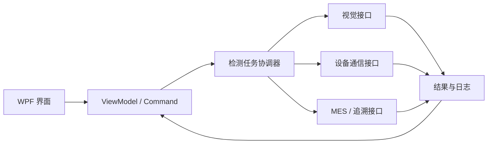

# NormalPackMachine Portfolio | 工业视觉上位机作品集

> C# · WPF · MVVM · .NET Framework 4.8 · 工业视觉 · 设备通信

这是为求职和技术交流独立整理的**脱敏作品集**，展示 Windows 包装设备上位机的设计思路，包含**独立编写、仅使用模拟数据的 WPF 示例程序**。本仓库**不是**原生产软件的开源副本，也不能用于控制生产设备。

**English:** [README.en.md](README.en.md)

## 项目展示

| 能力方向 | 工程要点 | 公开形式 |
| --- | --- | --- |
| WPF / MVVM | 运行状态、OK/NG 统计、日志、命令与属性绑定 | 独立模拟代码 |
| 并发与取消 | 异步检测任务、CancellationToken、UI 线程更新 | 独立模拟代码 |
| 工业视觉 | 采集 → 检测 → 判定 → 记录 | 概念架构 |
| PLC / OPC UA | 设备适配器、状态通信、超时与异常处理 | 架构说明 |
| MES / 追溯 | 数据交互边界、失败重试和幂等性设计 | 架构说明 |
| 构建验证 | Windows x64 / VS2022 / .NET Framework 4.8 | 验证清单 |

## 独立模拟器

查看 [examples/WpfSimulator/](examples/WpfSimulator/README.md)，在 Windows + Visual Studio 2022 + .NET Framework 4.8 Developer Pack 中打开 `WpfSimulator.csproj`，以 Debug / Any CPU 构建运行。

- 模拟双工位检测、结果计数和运行日志。
- 支持启动和停止、异步取消、状态绑定。
- 自有 NormalPack 蓝色图标与启动页。
- **无需 HALCON、PLC、相机、MES 或私有 NuGet 包。**
- 结果均为合成数据，**不连接真实工业设备**。

> 本示例仅完成静态检查，**尚未在 Windows / VS2022 下实际编译运行**，见 [验证清单](docs/VALIDATION.md)。

## 架构概念

这是通用设计示例，不代表私有工程的完整源码结构。

## 项目背景

相关工程场景为 Windows 包装设备上位机，涉及视觉检测、设备状态监控、PLC/OPC UA、生产日志和 MES 数据交互。公开模拟器只展示通用方法，不包含 HALCON 算法、真实配方、设备接线/点位、生产命令、客户协议或商业 SDK。

## 相关文档

[架构说明](docs/ARCHITECTURE.md) · [验证清单](docs/VALIDATION.md) · [发布检查](docs/PUBLICATION-CHECKLIST.md) · [图标与启动页](docs/BRANDING.md)

## 隐私、保密与权属

- 不上传原私有仓库历史、客户源码、厂商 DLL、许可证、账号、网络地址、生产图片和配方。
- 模拟程序由独立示例构成，**不表示原商业工程已获开源授权**。
- 个人贡献与实际效果需以可验证的事实为准；真实截图和商业素材须获得相应许可后才能发布。

本仓库暂不附加开源许可证。
