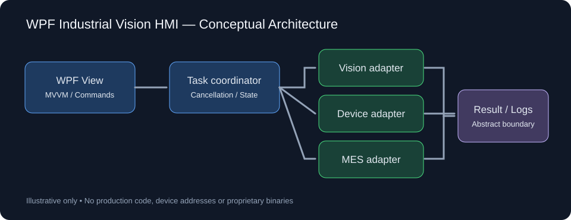

# NormalPack Studio

**工业视觉上位机 · C# / WPF 工程实践**

围绕自动化包装设备的视觉检测与生产过程管理，梳理 Windows 上位机在**设备协同、检测流程、状态管理和人机交互**方面的设计与实现。项目关注的不只是界面呈现，也包括异步任务的生命周期、异常状态的可追踪性，以及现场软件的可维护性。

[C#](https://learn.microsoft.com/dotnet/csharp/) · [WPF](https://learn.microsoft.com/dotnet/desktop/wpf/) · MVVM · .NET Framework 4.8 · PLC / OPC UA · 机器视觉

[English](README.en.md)

## 项目概览

工业视觉上位机通常需要在同一应用中协调检测任务、设备状态和生产数据。NormalPack Studio 以这一场景为背景，展示一套分层的软件设计思路，以及便于独立体验的 WPF 交互工程。

## 技术重点

| 方向 | 工程设计与实践 |
| --- | --- |
| **WPF / MVVM** | 界面与业务状态分离，使用命令、数据绑定与通知机制组织交互 |
| **异步任务管理** | 通过 `async/await` 与 `CancellationToken` 处理检测任务启动、停止和取消 |
| **检测结果管理** | 维护双工位检测状态、OK/NG 统计与滚动日志，便于观察运行过程 |
| **工业视觉架构** | 按采集、检测、判定与结果记录划分职责，降低算法与界面的耦合 |
| **设备与系统集成** | 围绕 PLC / OPC UA、MES 和追溯设计通信边界、异常处理与数据流转 |
| **工程维护** | 关注线程安全、接口隔离、依赖兼容、配置迁移和现场验证 |

其中 **WPF 交互、任务控制与检测统计**提供了可阅读的示例代码；**视觉算法、PLC 通信和 MES 协同**通过架构文档说明设计思路。

## WPF 交互示例

仓库中的 [WpfSimulator](examples/WpfSimulator/) 展示从启动画面进入控制台、启动检测任务、更新统计与查看日志的完整交互流程。

- 双工位轮流执行检测任务，展示 OK / NG 结果与统计。
- 支持任务启动、停止和取消，界面状态同步更新。
- 通过独立服务接口组织检测逻辑，便于理解模块边界。
- 使用统一的应用图标与启动界面。

检测数据由内置演示服务生成，无需连接实际设备即可查看交互行为。

## 本地运行

**环境：** Windows、Visual Studio 2022、.NET Framework 4.8 Developer Pack。

1. 克隆本仓库。
2. 在 Visual Studio 中打开 `examples/WpfSimulator/WpfSimulator.csproj`。
3. 选择 **Debug / Any CPU**，构建并启动。
4. 通过“启动模拟”和“停止模拟”体验检测状态与日志更新。

> 本示例尚待完成 Windows / VS2022 实际编译和运行验证，验证项见 [VALIDATION.md](docs/VALIDATION.md)。

## 项目文档

- [架构与模块设计](docs/ARCHITECTURE.md)：WPF、检测任务、视觉接口与设备通信的职责划分
- [品牌与启动界面](docs/BRANDING.md)：NormalPack Studio 视觉资源
- [验证清单](docs/VALIDATION.md)：构建、运行与回归检查
- [发布检查](docs/PUBLICATION-CHECKLIST.md)：工程分享时的资源与配置边界

## 说明

本仓库聚焦上位机通用架构与交互设计。示例中的检测结果为演示数据，通信模块为设计说明，不包含现场设备协议、生产配置或需授权的第三方运行库；实际产线部署须另行完成设备适配与验证。

本仓库未附加开源许可证。
