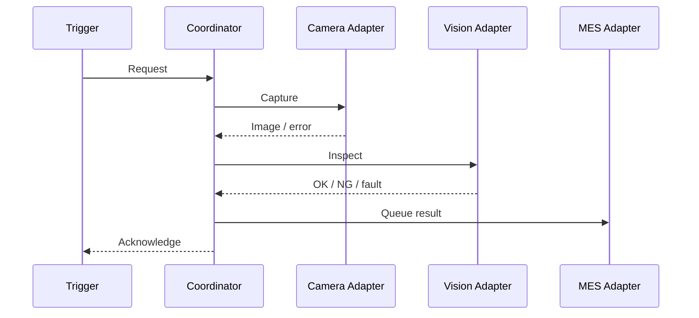

# 工业视觉上位机架构 — 脱敏概念设计

> 技术交流用的通用架构示例，不是生产工程的接口定义或源码结构。

## 模块职责

1. **展示层 WPF / MVVM：** 展示工位状态、生产计数、日志与操作命令，不在 UI 线程进行阻塞式设备调用。
2. **检测任务协调：** 定义启动、停止、取消、异常及超时状态，隔离任务和 UI 生命周期。
3. **视觉接口：** 将相机采集与算法实现隔离；公开项目只有模拟检测，没有 HALCON 或机器图像。
4. **设备适配器：** 将 PLC / OPC UA 和其他外设连接抽象为独立边界。
5. **追溯与 MES：** 将结果写入日志或交给异步处理模块，区分暂时失败与永久失败。

## 一次检测的概念流程

以上仅是教学流程，真实 PLC 信号、互锁条件、时序及报文需按现场协议、安全评估与测试结果设计。

## 工程风险

- **UI 与线程安全：** 后台任务异步进行，UI 绑定集合在 Dispatcher 上更新。
- **通讯异常：** 应区分业务 NG、通信错误、超时与主动取消，绝不能把检测异常自动当成 OK。
- **角度与坐标：** 必须指定基准方向和角度归一化区间，并测试 0° / 180° 边界。
- **序列化兼容：** 旧配方如果包含 .NET 类型信息，改名可能导致无法反序列化。
- **设备依赖：** 工控机的 x64 位数、HALCON、相机 SDK 和设备 DLL 需要版本匹配。
- **MES 重试：** 避免失联时数据丢失或重复写入。

## 公开示例映射

| 设计概念 | 独立模拟器 |
| --- | --- |
| 展示界面 | `MainWindow.xaml` |
| 状态绑定与任务控制 | `ViewModels/MainViewModel.cs` |
| 命令模式 | `Infrastructure/RelayCommand.cs` |
| 视觉抽象边界 | `Services/IInspectionService.cs` |
| 合成检测数据 | `Services/SimulatedInspectionService.cs` |

不包含商业 HALCON 算法、真实通信协议、生产控制逻辑或客户 MES 接口。
